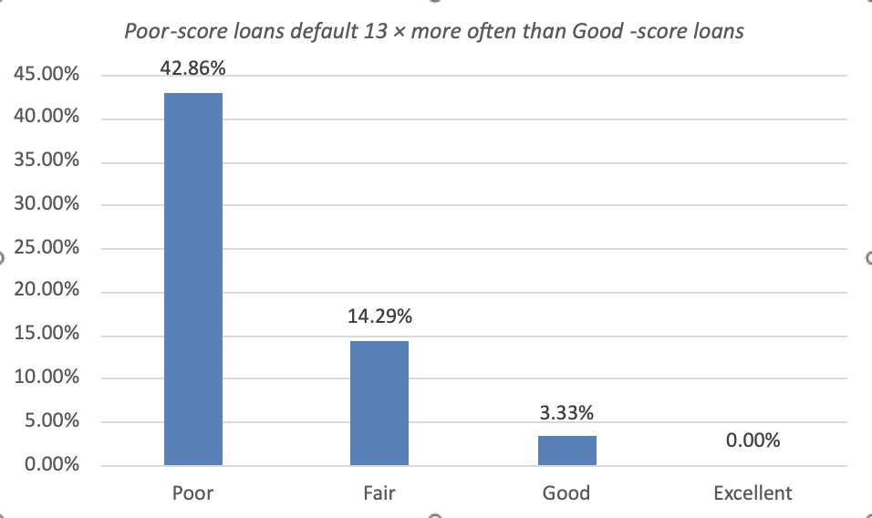

# Credit-score risk bands: where should a bank set its lending cut-off? (banking)

**Business question:** the head of credit risk at Banco Atlântico (fictional) asked whether the bank should lend to customers with credit scores below 600, and how default risk changes with score.

**Data:** `loans_raw.csv`: 61 loan rows (LoanID, Branch, Product, Amount, CreditScore, Status). Synthetic data with two seeded quality issues.

**Approach (Excel for the web, workbook `credit_risk_bands.xlsx`)**
1. **Protect raw data:** `Raw` sheet untouched; all work in `Clean`, a Table named `Loans`.
2. **Profile and clean:** `COUNT` vs `COUNTA` found a score stored as text (`"669 "`, trailing space; it would have been banded "Excellent", because Excel ranks text above numbers); `COUNTIFS(Loans[LoanID],[@LoanID])` found duplicate loan L040. Result: 60 clean loans, all scores numeric.
3. **Band each loan with `IFS`:** Poor < 580 · Fair 580–669 · Good 670–739 · Excellent 740+ (conditions checked in order, `TRUE` as catch-all).
4. **Summary sheet:** one formula per column dragged down: `COUNTIFS` for loans and defaults, an `IF` guard for the default rate, share of loans with an absolute reference (`=B2/B$6`), `AVERAGEIFS` for average score; total row reconciles to 60 loans and 6 defaults.

**Result**

| Band | Loans | Defaults | Default rate | Share of loans | Avg score |
|---|---|---|---|---|---|
| Poor | 7 | 3 | 42.9% | 11.7% | 538.0 |
| Fair | 14 | 2 | 14.3% | 23.3% | 633.7 |
| Good | 30 | 1 | 3.3% | 50.0% | 699.4 |
| Excellent | 9 | 0 | 0.0% | 15.0% | 768.7 |
| **Total** | **60** | **6** | **10.0%** | **100%** | **675.6** |

**Insight:** Poor-score loans default about 13× more often than Good-score loans. With an assumed 60% loss given default, a Poor-band loan loses ≈ €26 per €100 lent, more than any normal interest margin.

**Recommendation:** keep the cut-off at 580; consider the 580–669 band only with risk-based pricing. Full reasoning in [`memo.md`](memo.md).

**Limitations:** small bands (Poor = 7 loans, so its rate is noisy); loss given default is assumed, not measured; no interest-rate or cost data yet, so this is risk, not profit.

**Skills:** Excel Tables and structured references · data profiling and cleaning · `IFS` · `COUNTIFS` / `AVERAGEIFS` · relative vs absolute references · decision memo
